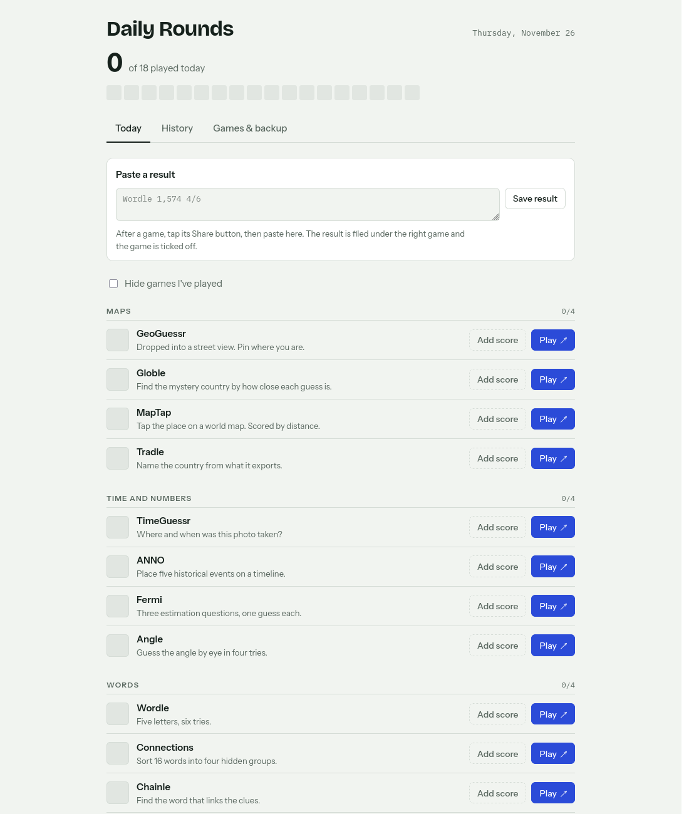

# Daily Rounds

**Live:** https://arrnb.github.io/daily-rounds/

A launcher, daily checklist and score log for the daily web games I play
(GeoGuessr, Wordle, Connections, Globle, TimeGuessr and more). Paste a game's
Share result and Daily Rounds works out which game it came from, pulls out the
score and ticks the game off for the day. It also tracks history and streaks.



## Features

- **One-tap launcher** for 22 daily games, grouped by type with a progress strip for today
- **Share-text parser.** It recognises each game's share format (emoji grids,
  `4/6`-style scores, point totals, fractions) and files the result under the right game
- **History and streaks** per game
- **Installable PWA** that works from the home screen on phone or desktop
- **Private by design.** Everything is stored in your browser's `localStorage`, with
  JSON export/import for backup. There is no server and no account.
- **Customisable game list.** Add, edit or remove games.
- **Favourites.** Tap the heart next to Play to pin a game to a Favourites section at the top
- **Themes.** Auto, Light, Dark, Sepia, Rose, Ocean, Midnight and Black (AMOLED), picked from the top right
- **Share straight to the app (Android).** Install Daily Rounds to your home screen, then tap Share
  in any game and choose Daily Rounds from the share sheet. No extension needed. There is also a
  one-tap *Paste from clipboard* button for games that only copy their result

## Share catcher (optional userscript)

For desktop browsers and Firefox for Android. Chrome and Samsung Internet on Android can't run
userscripts, so on those use the share sheet instead (see above).

[`daily-rounds-catcher.user.js`](daily-rounds-catcher.user.js) removes the
copy-paste step. Install it with Tampermonkey or Violentmonkey. When you press
Share inside a supported game, the script keeps the result in its own storage and
hands it over the next time you open Daily Rounds. It sends nothing anywhere else.

## Tech

A single static `index.html` with vanilla JavaScript and CSS and no build step or
dependencies, plus a web app manifest. It's hosted on GitHub Pages.

## Run locally

```bash
git clone https://github.com/ArrnB/daily-rounds.git
cd daily-rounds
python -m http.server 8000   # then open http://localhost:8000
```
